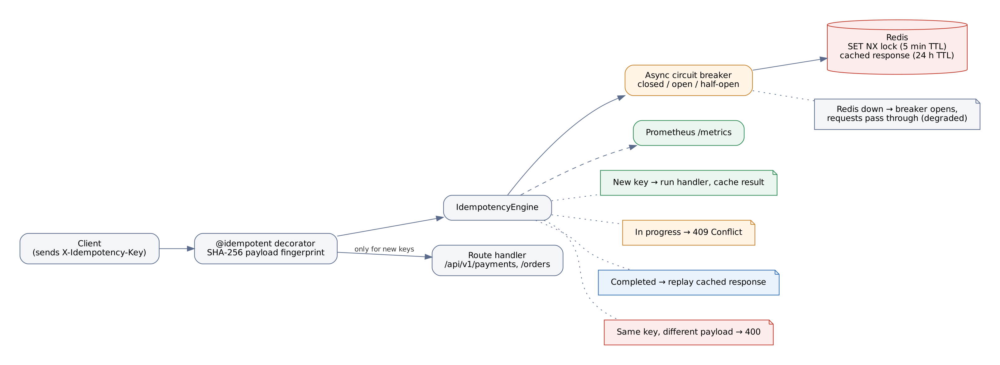
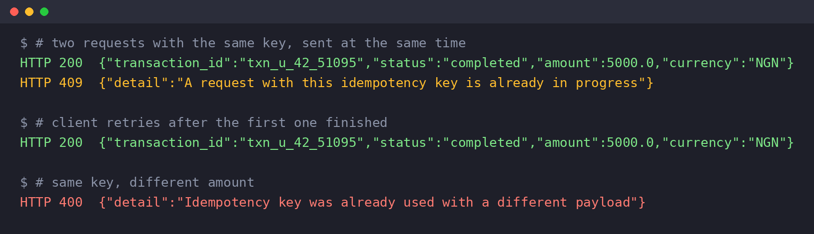
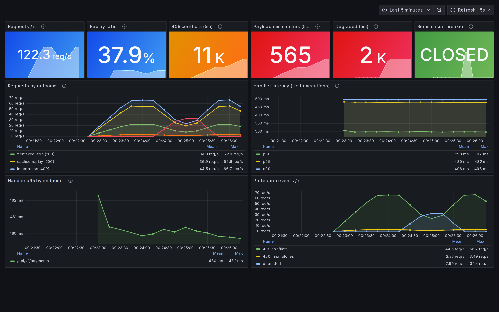

# Async Idempotency Engine

Production-grade idempotency handling for distributed systems built with FastAPI, Redis, and circuit-breaking resilience.

## The Problem

Modern distributed systems face the idempotency challenge: network failures, client retries, and load balancer replays can cause duplicate requests. Without idempotency, a single payment request might charge a customer twice, an order might be placed multiple times, or any state-changing operation could be unintentionally repeated.

Traditional solutions are either too naive (database unique constraints that fail late) or too heavyweight (distributed transactions that kill throughput). This engine provides a pragmatic middle ground: atomic Redis-backed request deduplication with circuit-breaking fallback and zero false negatives.

## Architecture & System Design



### State Machine

Every request flows through a three-state lifecycle:

1. **New Request**: No prior execution. The engine acquires a distributed lock via Redis SETNX, stores the payload hash, and allows the operation to proceed.

2. **In-Progress**: Another instance is currently processing this idempotency key. Return `409 Conflict` immediately—no queueing, no spinning.

3. **Completed**: The operation finished. Return the cached response from Redis without re-executing.

### What it looks like

Real output from a local run (Redis 7, one Uvicorn worker):



### Core Components

**Decorator**: The `@idempotent` decorator wraps FastAPI route handlers. It extracts the `X-Idempotency-Key` header, computes a SHA-256 hash of the request payload, and coordinates with the engine.

**Engine**: Manages Redis interactions through `pybreaker` circuit breakers. On Redis failure (network partition, instance crash), the breaker opens and requests pass through unprotected rather than failing hard.

**Payload Hashing**: SHA-256 fingerprint of the JSON body. If the same idempotency key arrives with a different payload, the engine rejects it with `400 Bad Request`—this prevents malicious or accidental payload tampering.

**TTL Strategy**: Locks expire after 5 minutes (configurable), completed responses after 24 hours. This bounds memory and handles crashed workers that never release locks.

### Observability

Prometheus metrics expose:
- `idempotency_cache_hits_total`: Replayed responses served from cache
- `idempotency_cache_misses_total`: Keys claimed for first-time execution
- `idempotency_lock_conflicts_total`: Concurrent attempts blocked with 409
- `idempotency_payload_mismatch_total`: Retries rejected for a changed payload
- `idempotency_degraded_total`: Requests passed through while Redis was unreachable
- `idempotency_execution_seconds`: Latency histogram, labelled by endpoint and outcome
- `idempotency_breaker_open`: 1 while the Redis circuit breaker is open

Scrape `/metrics` for real-time idempotency behavior. After the demo above:

```text
idempotency_cache_hits_total 1.0
idempotency_cache_misses_total 1.0
idempotency_lock_conflicts_total 1.0
idempotency_payload_mismatch_total 1.0
idempotency_degraded_total 0.0
idempotency_breaker_open 0.0
```

## Monitoring with Prometheus and Grafana

The repo ships a full monitoring stack: Prometheus scrapes `/metrics` every 5 seconds and Grafana loads a ready-made dashboard on startup.

```bash
docker compose up --build -d                       # API, Redis, Prometheus, Grafana
pip install httpx
python scripts/load.py --seconds 120               # mixed traffic: duplicates, retries, changed payloads
```

Open http://localhost:3000. The **Async Idempotency Engine** dashboard opens as the home page (no login needed locally).



*A 200-second load test with Redis stopped for 35 seconds in the middle: requests degrade to pass-through (red), the breaker opens, then closes again once Redis is back. The screenshot is regenerated by the `Grafana dashboard snapshot` GitHub Actions workflow.*

| Panel | What it tells you |
|---|---|
| Requests / s, Replay ratio | Throughput and how much traffic is answered from the cache |
| 409 conflicts, Payload mismatches | Duplicates and changed payloads the engine blocked |
| Degraded, Redis circuit breaker | Whether Redis is down and idempotency is switched off |
| Requests by outcome | First executions, replays, 409s, 400s and degraded requests over time |
| Handler latency | p50 / p95 / p99 of first executions, overall and per endpoint |
| Protection events / s | Rate of 409s, 400s and degraded requests |

To watch the circuit breaker trip, stop Redis while the load script runs:

```bash
docker compose stop redis      # breaker goes OPEN, Degraded starts climbing
docker compose start redis     # breaker closes again after the timeout
```

## Kubernetes deployment (Terraform + Ansible)

`deploy/` runs the engine on a local multi-node Kubernetes cluster:

- **Terraform** (`deploy/terraform`) creates a kind cluster with one control-plane node and two workers, and maps the API's NodePort to `localhost:8080`.
- **Ansible** (`deploy/ansible`) builds the image, loads it into the nodes, renders the Kubernetes manifests from Jinja2 templates, waits for the rollout and smoke-tests the API: first request 200, retry replayed from cache, changed payload 400.
- **Kubernetes**: Redis plus 3 API replicas spread across nodes, readiness and liveness probes on `/health`, a `preStop` drain so terminating pods stop receiving traffic before shutdown, a rolling update (`maxUnavailable: 0`) and a PodDisruptionBudget keeping at least 2 replicas up.

```bash
make up      # terraform apply + ansible-playbook
make load    # mixed traffic against http://localhost:8080
make down    # terraform destroy
```

Requires Docker, kind, kubectl, Terraform, and `pip install ansible-core kubernetes` plus `ansible-galaxy collection install kubernetes.core`.

The `Kubernetes deploy` GitHub Actions workflow runs all of this on every change, then tests resilience under load (10 concurrent clients, 60 s each):

| Scenario | 200 | 409 | 400 | Failed requests |
|---|---|---|---|---|
| One API pod deleted mid-run | 2,343 | 1,991 | 98 | 0 |
| Rolling restart of all replicas | 2,288 | 1,907 | 122 | 0 |

409s are concurrent duplicates and 400s are deliberately changed payloads from the load script, so both are expected. The client retries a failed connection once, as a real client would.

## Tech Stack

- **FastAPI**: Async request handling, dependency injection, automatic OpenAPI docs
- **Redis**: Atomic SETNX primitive for distributed locking, sub-millisecond reads
- **Pydantic v2**: Request validation and settings management
- **Custom async circuit breaker** (`app/idempotency/breaker.py`): Degrades gracefully under Redis failure
- **prometheus_client**: Metrics export for observability
- **pytest + httpx**: Async test suite with mocked Redis
- **Grafana**: Provisioned dashboard for request outcomes, latency and breaker state
- **Terraform, Ansible, Kubernetes (kind)**: Infrastructure as code, templated deployment and multi-replica runtime

### A note on the circuit breaker

The original design called for `pybreaker`. Its `call_async` method is implemented
with `@gen.coroutine` from **Tornado**, and silently no-ops unless Tornado is installed
(`HAS_TORNADO_SUPPORT`). Pulling a second web framework into an asyncio service to get
a decorator is a poor trade, so the breaker here is a ~45-line asyncio-native
implementation with the same closed/open/half-open semantics. Swapping it back is a
one-line change in `IdempotencyEngine.__init__` if Tornado is acceptable in your stack.

## Local Setup

### Prerequisites

- Python 3.11+
- Redis 6.2+ running locally or accessible via network

### Installation

```bash
python -m venv venv
source venv/bin/activate
pip install -r requirements.txt
```

### Configuration

Copy the example environment file and adjust values:

```bash
cp .env.example .env
```

Set `REDIS_URL` to a full connection string (`redis://` or `rediss://`) when your
provider hands you one, as Render and most managed hosts do. Leave it blank to fall
back to the discrete `REDIS_HOST` / `REDIS_PORT` / `REDIS_PASSWORD` values.

Start Redis:

```bash
redis-server
```

Or use Docker:

```bash
docker run -d -p 6379:6379 redis:7-alpine
```

### Run the Server

```bash
uvicorn app.main:app --host 0.0.0.0 --port 8000 --reload
```

The API will be available at `http://localhost:8000`.

Interactive docs: `http://localhost:8000/docs`

### Testing

Run the test suite:

```bash
pytest tests/ -v
```

### Example Usage

**First request** (executes and caches):

```bash
curl -X POST http://localhost:8000/api/v1/payments \
  -H "Content-Type: application/json" \
  -H "X-Idempotency-Key: payment-20260806-001" \
  -d '{"user_id": "user123", "amount": 100.0, "currency": "USD"}'
```

**Retry with same key** (returns cached response):

```bash
curl -X POST http://localhost:8000/api/v1/payments \
  -H "Content-Type: application/json" \
  -H "X-Idempotency-Key: payment-20260806-001" \
  -d '{"user_id": "user123", "amount": 100.0, "currency": "USD"}'
```

**Concurrent duplicate** (while first is running):

```bash
HTTP/1.1 409 Conflict
{"detail": "Request already in progress"}
```

**Tampered retry** (same key, different payload):

```bash
curl -X POST http://localhost:8000/api/v1/payments \
  -H "Content-Type: application/json" \
  -H "X-Idempotency-Key: payment-20260806-001" \
  -d '{"user_id": "user123", "amount": 200.0, "currency": "USD"}'

HTTP/1.1 400 Bad Request
{"detail": "Payload mismatch for idempotency key"}
```

### Metrics

Scrape Prometheus metrics:

```bash
curl http://localhost:8000/metrics
```

Sample output:

```
idempotency_cache_hits_total 142.0
idempotency_cache_misses_total 38.0
idempotency_lock_conflicts_total 5.0
idempotency_payload_mismatch_total 2.0
idempotency_degraded_total 0.0
idempotency_breaker_open 0.0
idempotency_execution_seconds_bucket{endpoint="/api/v1/payments",outcome="acquired",le="0.5"} 35.0
```

## Deploying to Render

The repository ships a `render.yaml` blueprint that provisions both the web service
and a managed Redis (Key Value) instance, wiring `REDIS_URL` between them automatically.

1. In the Render dashboard choose **New → Blueprint** and point it at this repository.
2. Render reads `render.yaml`, creates the web service plus the `idempotency-store`
   Key Value instance, and injects its connection string as `REDIS_URL`.
3. Confirm the deployment is fully operational, not degraded:

```bash
curl https://<your-service>.onrender.com/health
```

A healthy deployment reports `"redis_connected": true` and `"idempotency": "active"`.
If it reports `"idempotency": "degraded"`, Redis is unreachable and the engine is
passing every request through without deduplication.

**Without Redis attached the service still starts and returns 200s, but idempotency
is a silent no-op** — the circuit breaker degrades open by design. Always check
`/health` after deploying rather than assuming a 200 on `/` means the engine is live.

Note that Render's free Key Value plan has no persistence: cached responses are lost
on restart, which widens the window for a duplicate charge after a redeploy. Use a
paid plan with persistence for anything handling real money.

### Deployment Considerations

- Set `IDEMPOTENCY_TTL` based on your retry window (default 24h)
- Tune `CIRCUIT_BREAKER_FAIL_MAX` and `CIRCUIT_BREAKER_TIMEOUT` for your Redis reliability
- Use Redis Cluster or Sentinel for HA
- Run multiple FastAPI workers behind a load balancer
- Monitor the `lock_conflicts` metric—sustained high values indicate clients aren't respecting 409s
